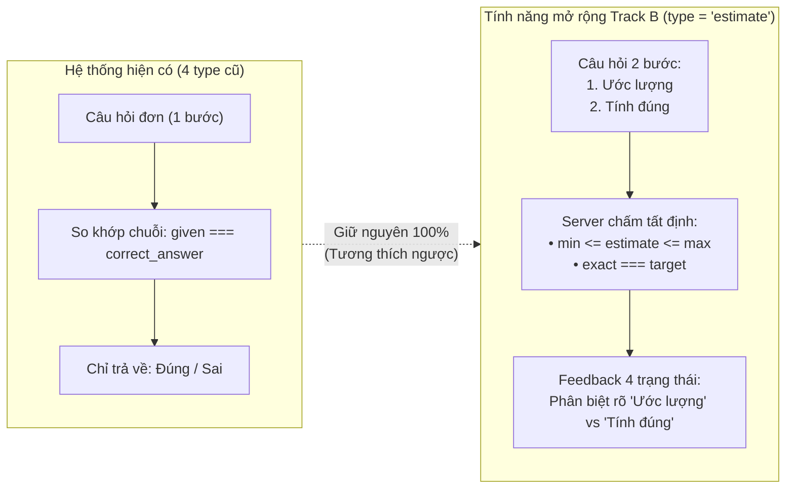
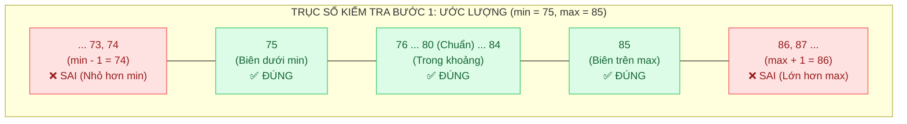
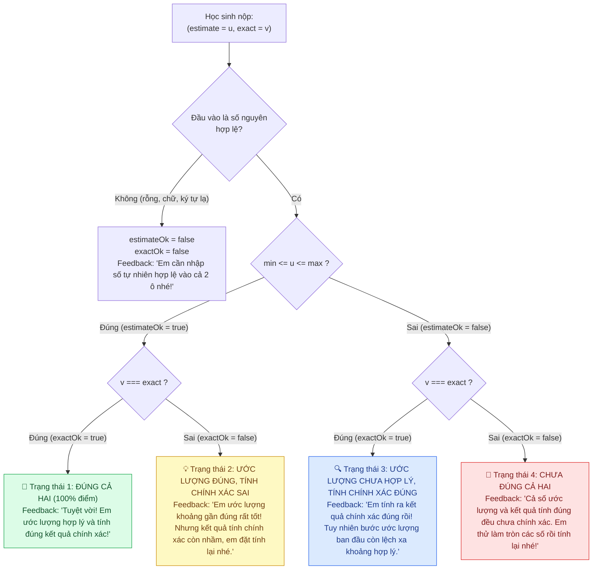
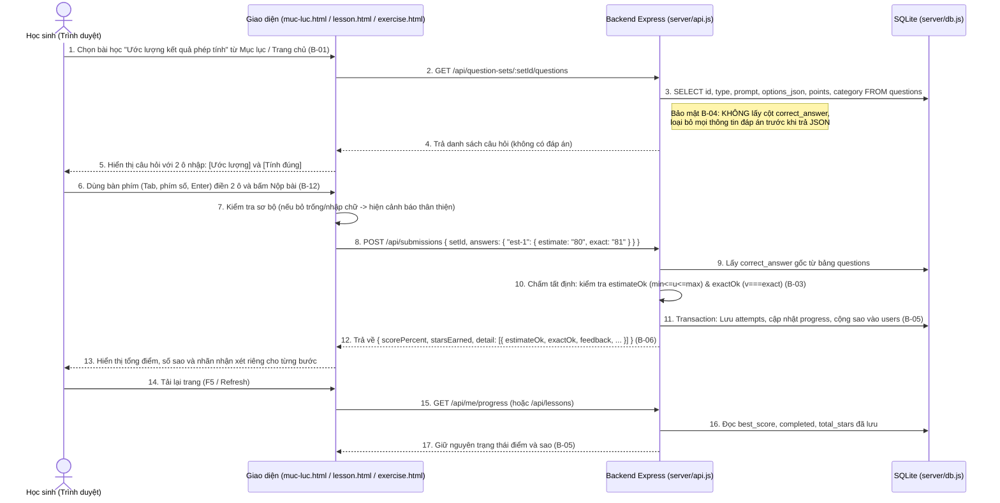

# TÀI LIỆU ĐẶC TẢ YÊU CẦU (REQUIREMENTS.md)
**Dự án:** Vườn Toán Lớp 3 — Mở rộng dạng bài *"Ước lượng trước khi tính đúng"* (Track B)  
**Mốc bàn giao:** M1 — Understand (05–08/11/2026)

---

## 1. Giới thiệu & Bối cảnh hệ thống (System Context)

### 1.1. Hiện trạng hệ thống (Baseline)
Hệ thống **Vườn Toán Lớp 3** hiện tại là một ứng dụng web phục vụ học sinh lớp 3 luyện tập và kiểm tra Toán theo chương trình Sách Giáo Khoa. Hệ thống sử dụng kiến trúc:
- **Frontend:** HTML5, Tailwind CSS, Vanilla JavaScript (`public/*.html`, `public/assets/js/pages/*.js`).
- **Backend:** Node.js + Express (`server/index.js`, `server/api.js`, `server/auth.js`).
- **Cơ sở dữ liệu:** SQLite đồng bộ qua `better-sqlite3` (`server/db.js`, lưu tại `data/vuon-toan.db`, khởi tạo từ `data/seed.json`).

Hiện tại, bảng `questions` và cơ chế chấm điểm tại `POST /api/submissions` chỉ hỗ trợ **4 loại câu hỏi (`type`)** với cơ chế **so khớp chuỗi tuyệt đối** (`given === correct_answer`):
1. `multiple-choice`: Trắc nghiệm chọn 1 đáp án đúng (`A`, `B`, `C`, `D`).
2. `input`: Điền 1 số cố định vào ô trống (ví dụ: `"9"`).
3. `compare`: Điền dấu so sánh (`">"`, `"<"`, `"="`).
4. `paint`: Tô màu thẻ phép tính theo kết quả (`"green"`, `"yellow"`).

### 1.2. Vấn đề cần giải quyết (Problem Statement)
Trong chương trình Toán lớp 3, kỹ năng **"Ước lượng kết quả phép tính"** (thông qua làm tròn số đến hàng chục, hàng trăm) trước khi thực hiện tính chính xác giúp học sinh phát triển cảm nhận về số (number sense) và tự phát hiện sai sót khi tính toán.

Tuy nhiên, hệ thống hiện tại **chưa thể biểu diễn và chấm điểm** dạng bài này vì:
1. Một câu hỏi *"Ước lượng trước khi tính đúng"* đòi hỏi học sinh thực hiện **2 bước trả lời** trên cùng một câu hỏi: (1) Nhập giá trị ước lượng và (2) Nhập kết quả tính đúng.
2. Giá trị ước lượng có thể chấp nhận một **khoảng giá trị hợp lý `[min, max]`** (hoặc giá trị làm tròn chuẩn tắc) thay vì chỉ so sánh chuỗi cứng với một số duy nhất.
3. Hệ thống cần phản hồi (feedback) tách biệt rõ ràng giữa việc học sinh *"ước lượng hợp lý"* hay chưa và *"kết quả tính chính xác"* đúng hay sai (**B-06**).

---

## 2. Phạm vi dự án (Project Scope)

### 2.1. Trong phạm vi (In-Scope)
- **Tích hợp luồng học (B-01):** Đưa dạng bài mới (`type = 'estimate'`) vào trực tiếp luồng học tập hiện có của học sinh (truy cập từ Trang chủ / Mục lục SGK `muc-luc.html` $\rightarrow$ Trang làm bài `lesson.html` và/hoặc Phiếu luyện tập `exercise.html`).
- **Dữ liệu câu hỏi mẫu (B-02):** Xây dựng tối thiểu **12 câu hỏi synthetic** (hư cấu, chuẩn chương trình Toán lớp 3) trong `data/seed.json`, tự động nạp vào SQLite khi khởi tạo.
- **Logic toán học & Chấm điểm phía Server (B-03, B-04, B-05, B-06):**
  - Định nghĩa quy tắc tạo khoảng ước lượng `[min, max]` và đáp án đúng `exact` hoàn toàn tất định (deterministic).
  - Đảm bảo API `GET /api/question-sets/:setId/questions` ẩn toàn bộ đáp án (`correct_answer`, `min`, `max`, `exact`) trước khi nộp bài.
  - Chấm điểm trên Server tại `POST /api/submissions`, lưu kết quả vào bảng `attempts`, `progress`, cộng sao vào `users` và trả về phản hồi phân biệt rõ bước *"Ước lượng"* với bước *"Tính đúng"*.
- **Trải nghiệm người dùng & Khả năng tiếp cận (B-12):** Hỗ trợ điều hướng và nộp bài hoàn toàn bằng bàn phím (`Tab`, `Shift+Tab`, `Enter`), hiển thị thông báo lỗi tiếng Việt thân thiện cho học sinh lớp 3.
- **Kiểm thử tự động & CI (B-08, B-09, B-10):** Thiết lập lệnh `npm test` (chạy từ clean checkout) bao phủ các ca kiểm thử `normal`, `boundary`, `invalid input`, `scoring/regression` và cấu hình GitHub Actions CI chạy `npm ci && npm test`.

### 2.2. Ngoài phạm vi & Ràng buộc bất biến (Out-of-Scope — B-07, B-11)
> [!CAUTION]
> Nhóm cam kết **TUYỆT ĐỐI KHÔNG SỬA ĐỔI** các thành phần sau theo đúng yêu cầu **B-07** và **B-11**:
> 1. Toàn bộ file `server/auth.js` (cơ chế tạo/kiểm tra token, session/cookie, bcrypt).
> 2. Các route xác thực và quản trị trong `server/api.js`: `/api/auth/*`, `/api/teacher/*`, `/api/admin/*`.
> 3. Danh sách và mật khẩu các tài khoản mẫu trong `data/seed.json` (`hocsinh01`..`hocsinh99`, `giaovien01`).
> 4. Cấu hình đóng gói và triển khai hệ thống (`Dockerfile`, `.dockerignore`, `DEPLOY.md`).
> 5. Hành vi và dữ liệu của 4 loại câu hỏi cũ (`multiple-choice`, `input`, `compare`, `paint`).
> 6. Không đưa bất kỳ thông tin định danh cá nhân thật (PII) hay khóa bí mật (API key, secret) vào mã nguồn.

---

## 3. Quy tắc Toán học Tất định: Giải thích chi tiết `min`, `max` và `exact` (B-03, B-06)

Để việc tạo câu hỏi và chấm điểm **không phụ thuộc vào cảm tính** và **không có yếu tố ngẫu nhiên**, nhóm định nghĩa mô hình toán học tất định dựa trên quy tắc làm tròn số Lớp 3 (Chương trình GDPT 2018).

### 3.1. Các khái niệm cốt lõi trong 1 câu hỏi Ước lượng

Mỗi câu hỏi dạng `"estimate"` yêu cầu học sinh giải một biểu thức số học $A \oplus B$ (với phép toán $\oplus \in \{+, -, \times, :\}$) qua **2 bước**:
1. **Bước 1 — Ước lượng (`estimate`):** Học sinh làm tròn các số hạng đến hàng chục (hoặc hàng trăm) rồi nhẩm nhanh kết quả. Học sinh nhập vào số nguyên $u$.
2. **Bước 2 — Tính đúng (`exact`):** Học sinh thực hiện phép tính chi tiết để tìm kết quả đúng tuyệt đối. Học sinh nhập vào số nguyên $v$.

Trên Server, mỗi câu hỏi được gắn với 3 tham số số nguyên cố định $(min, max, exact)$ thỏa mãn $min \le max$:
- **`exact` (Kết quả chính xác):** Là giá trị đúng tuyệt đối của phép tính $A \oplus B$.
- **`canonical` (Giá trị ước lượng chuẩn tắc):** Là kết quả thu được khi làm tròn từng số hạng theo quy tắc chuẩn SGK (chữ số hàng làm tròn $< 5$ làm tròn xuống, $\ge 5$ làm tròn lên) rồi thực hiện phép tính:
  $$\text{round}_{10}(n) = \left\lfloor \frac{n + 5}{10} \right\rfloor \times 10, \quad \text{round}_{100}(n) = \left\lfloor \frac{n + 50}{100} \right\rfloor \times 100$$
- **`min` (Cận dưới hợp lý) & `max` (Cận trên hợp lý):** Là biên dưới và biên trên của **khoảng ước lượng hợp lý `[min, max]`** (bao gồm cả 2 đầu mút `min` và `max`).

### 3.2. Tại sao cần có khoảng `[min, max]` và công thức xác định `min`, `max` như thế nào?

Trong thực tế giảng dạy Toán lớp 3, khi ước lượng một phép tính như $38 + 43$:
- **Cách 1 (Làm tròn chuẩn đến hàng chục):** $38 \approx 40$, $43 \approx 40 \Rightarrow 40 + 40 = \mathbf{80}$ (`canonical = 80`).
- **Cách 2 (Làm tròn rồi bù trừ nhanh / Ước lượng cận):** Học sinh thấy $38$ gần $40$, $43$ hơn $40$ một chút nên ước lượng trong khoảng từ **`75` đến `85`** (dung sai $\pm 5$ đơn vị ứng với nửa bậc làm tròn hàng chục $\Delta = \frac{10}{2} = 5$).
- Ngược lại, nếu đề bài yêu cầu rõ **"Làm tròn mỗi số đến hàng chục rồi ước lượng tổng"**, thì khoảng chấp nhận có thể thu hẹp hoặc mở rộng tùy theo bậc làm tròn $k$ ($k = 10$ cho hàng chục, $k = 100$ cho hàng trăm).

Để đảm bảo **Tính tất định 100% (B-03)**, quy tắc xác định `min` và `max` cho các câu hỏi trong hệ thống được khóa chặt bằng công thức sau:

| Nhóm bài toán Lớp 3 | Bậc làm tròn ($k$) | Công thức tính Ước lượng chuẩn ($E_{\text{std}}$) | Dung sai cho phép ($\delta$) | Khoảng hợp lý `[min, max]` | Ví dụ minh họa |
| :--- | :---: | :---: | :---: | :---: | :--- |
| **Nhóm 1:** Cộng/Trừ số có 2 chữ số (làm tròn hàng chục) | $k = 10$ | $E_{\text{std}} = \text{round}_{10}(A) \pm \text{round}_{10}(B)$ | $\delta = 5$ ($\frac{k}{2}$) | $[E_{\text{std}} - 5,\; E_{\text{std}} + 5]$ | $38 + 43 = 81$ $E_{\text{std}} = 40 + 40 = 80$ `min = 75`, `max = 85`, `exact = 81` |
| **Nhóm 2:** Cộng/Trừ số có 3 chữ số (làm tròn hàng trăm) | $k = 100$ | $E_{\text{std}} = \text{round}_{100}(A) \pm \text{round}_{100}(B)$ | $\delta = 50$ ($\frac{k}{2}$) | $[E_{\text{std}} - 50,\; E_{\text{std}} + 50]$ | $215 + 389 = 604$ $E_{\text{std}} = 200 + 400 = 600$ `min = 550`, `max = 650`, `exact = 604` |
| **Nhóm 3:** Nhân/Chia số có 2 chữ số với số có 1 chữ số | $k = 10$ | $E_{\text{std}} = \text{round}_{10}(A) \times B$ | $\delta = 5 \times B$ (hoặc cận dưới/trên hàng chục của $A$) | $[\lfloor A \rfloor_{10} \times B,\; \lceil A \rceil_{10} \times B]$ | $29 \times 3 = 87$ Cận: $20 \times 3 = 60$ đến $30 \times 3 = 90$ (Làm tròn chục: $E_{\text{std}} = 90$, `min = 80`, `max = 95`) |

### 3.3. Biểu đồ trực quan về khoảng `[min, max]` và các điểm biên (Boundary)

Giả sử câu hỏi: **"Ước lượng rồi tính: $38 + 43 = ?$"** với bộ tham số trên Server là:
- `min = 75`
- `max = 85`
- `canonical = 80` (40 + 40)
- `exact = 81`

**Công thức kiểm tra tất định trên Server:**
1. Kiểm tra định dạng đầu vào: Giá trị học sinh nhập cho từng ô phải là chuỗi biểu diễn một **số nguyên hợp lệ** (khớp biểu thức chính quy `/^-?\d+$/` sau khi `.trim()`, không rỗng, không chứa chữ cái hay `NaN`, và $\ge 0$).
2. Gọi $u = \text{Number}(givenEstimate)$ và $v = \text{Number}(givenExact)$:
   - **Điều kiện Ước lượng hợp lý (`estimateOk`):**
     $$\text{estimateOk} \iff (\text{Number.isInteger}(u)) \land (min \le u \le max)$$
   - **Điều kiện Kết quả chính xác (`exactOk`):**
     $$\text{exactOk} \iff (\text{Number.isInteger}(v)) \land (v === exact)$$
   - **Điều kiện Câu hỏi hoàn thành đúng (`correct`):**
     $$\text{correct} \iff \text{estimateOk} \land \text{exactOk}$$

### 3.4. Ma trận 4 trạng thái chấm điểm & Phản hồi chi tiết (B-06)

Để đáp ứng yêu cầu **B-06** (*"Có feedback phân biệt 'ước lượng hợp lý' với 'kết quả chính xác'"*), Server trả về trạng thái riêng cho từng bước:

---

## 4. Đặc tả Use Cases & Luồng tương tác (Use Cases & User Flows)

### 4.1. Sơ đồ trình tự tổng thể (Sequence Diagram)

### 4.2. Chi tiết các Use Cases

#### UC-01: Truy cập dạng bài "Ước lượng trước khi tính đúng" từ luồng học chính (`B-01`)
- **Tác nhân:** Học sinh đã đăng nhập (`hocsinh01`..`hocsinh99`).
- **Điều kiện tiên quyết:** Học sinh đang ở Trang chủ (`index.html`), Mục lục SGK (`muc-luc.html`), hoặc Luyện tập (`exercise.html`).
- **Luồng chính:**
  1. Trên danh sách bài học, học sinh thấy bài học/phiếu bài tập về **"Ước lượng kết quả phép tính"** nằm trong lộ trình học chính thức.
  2. Học sinh nhấn vào bài học để mở giao diện làm bài (`lesson.html?lesson=...&set=...` hoặc ngay trên `exercise.html`).
  3. Hệ thống hiển thị danh sách các câu hỏi ước lượng mà không cần truy cập qua đường dẫn ẩn hay trang demo tách rời.

#### UC-02: Làm bài với giao diện 2 bước hỗ trợ bàn phím (`B-12`)
- **Tác nhân:** Học sinh.
- **Luồng chính:**
  1. Với mỗi câu hỏi `type = 'estimate'`, giao diện hiển thị rõ đề bài (ví dụ: *"Làm tròn các số đến hàng chục để ước lượng, sau đó tính kết quả chính xác: 38 + 43"*).
  2. Giao diện cung cấp **2 ô nhập liệu có nhãn (`<label>`) rõ ràng**:
     - Ô 1: **"Bước 1: Ước lượng khoảng..."**
     - Ô 2: **"Bước 2: Kết quả tính đúng..."**
  3. Học sinh dùng phím `Tab` để chuyển từ Ô 1 sang Ô 2 và sang câu tiếp theo, dùng phím `Enter` để kích hoạt nút nộp bài.
- **Luồng ngoại lệ (Lỗi nhập liệu):**
  - Nếu học sinh nhập ký tự không phải số (ví dụ `"abc"`, `"80a"`) hoặc bỏ trống khi bấm nộp, giao diện đánh dấu viền cảnh báo tại ô đó và hiện thông báo tiếng Việt dễ hiểu (ví dụ: *"Em ơi, ô Ước lượng của câu 1 cần điền một con số nhé!"*).

#### UC-03: Chấm điểm trên Server và Nhận phản hồi kép (`B-03`, `B-04`, `B-05`, `B-06`)
- **Tác nhân:** Học sinh, Hệ thống Backend.
- **Luồng chính:**
  1. Học sinh bấm **"Nộp bài"**.
  2. Client gửi dữ liệu câu trả lời lên `POST /api/submissions`.
  3. Server giải mã cấu hình đáp án `(min, max, exact)` trong DB, chấm độc lập `estimateOk` và `exactOk`.
  4. Server ghi nhận lượt làm bài vào bảng `attempts`, cập nhật điểm cao nhất vào `progress` (đánh dấu `completed = 1` nếu đạt $\ge 50\%$) và cộng sao thưởng vượt kỷ lục vào bảng `users`.
  5. Giao diện nhận kết quả và hiển thị ngay dưới từng câu hỏi **2 huy hiệu (badges)**:
     - Huy hiệu 1: `Ước lượng hợp lý ✅` hoặc `Ước lượng chưa sát ❌ (Khoảng hợp lý: min – max)`.
     - Huy hiệu 2: `Tính đúng chính xác ✅` hoặc `Tính chính xác chưa đúng ❌ (Đáp số đúng: exact)`.

---

## 5. Đặc tả Dữ liệu & Bộ 12 Câu hỏi Mẫu (B-02, B-04)

### 5.1. Cách mã hóa câu hỏi `estimate` trong Database
Để giữ nguyên cấu trúc bảng `questions` hiện tại và đảm bảo tương thích 100% với code cũ:
- Cột `type`: Nhận giá trị mới là `'estimate'`.
- Cột `correct_answer`: Lưu chuỗi JSON chuẩn hóa hoặc định dạng tất định `"min-max|exact"` (ví dụ: `'{"min":75,"max":85,"exact":81,"canonical":80}'` hoặc `'75-85|81'`).
  - *Ưu điểm:* Không phá vỡ schema cũ, không bao giờ bị lộ qua `GET /api/question-sets/:setId/questions` vì câu lệnh `SELECT id,type,prompt,options_json,points,category FROM questions` trong `server/api.js` vốn đã loại trừ cột `correct_answer` (**B-04**).
- Cột `options_json`: Có thể lưu gợi ý bậc làm tròn hiển thị trên UI (ví dụ: `'{"roundTo":10,"unitLabel":"hàng chục"}'`) hoặc để `null`.

### 5.2. Danh sách 12 Fixture / Câu hỏi Synthetic tái lập được (`B-02`)

Dưới đây là 12 câu hỏi mẫu trong `data/seed.json` bao phủ đầy đủ các phép tính Cộng, Trừ, Nhân trong phạm vi chương trình Toán lớp 3:

| STT | Mã câu (`id`) | Đề bài (`prompt`) | Bậc làm tròn | Ước lượng chuẩn (`canonical`) | Khoảng hợp lý `[min, max]` | Kết quả đúng (`exact`) | Điểm (`points`) |
| :---: | :--- | :--- | :---: | :---: | :---: | :---: | :---: |
| 1 | `est-1` | Làm tròn đến hàng chục để ước lượng rồi tính: **38 + 43** | Hàng chục (10) | $40 + 40 = 80$ | `[75, 85]` | **81** | 5 |
| 2 | `est-2` | Làm tròn đến hàng chục để ước lượng rồi tính: **62 + 29** | Hàng chục (10) | $60 + 30 = 90$ | `[85, 95]` | **91** | 5 |
| 3 | `est-3` | Làm tròn đến hàng chục để ước lượng rồi tính: **81 - 28** | Hàng chục (10) | $80 - 30 = 50$ | `[45, 55]` | **53** | 5 |
| 4 | `est-4` | Làm tròn đến hàng chục để ước lượng rồi tính: **94 - 37** | Hàng chục (10) | $90 - 40 = 50$ | `[45, 60]` | **57** | 5 |
| 5 | `est-5` | Làm tròn đến hàng trăm để ước lượng rồi tính: **215 + 389** | Hàng trăm (100) | $200 + 400 = 600$ | `[550, 650]` | **604** | 10 |
| 6 | `est-6` | Làm tròn đến hàng trăm để ước lượng rồi tính: **482 + 316** | Hàng trăm (100) | $500 + 300 = 800$ | `[750, 850]` | **798** | 10 |
| 7 | `est-7` | Làm tròn đến hàng trăm để ước lượng rồi tính: **712 - 295** | Hàng trăm (100) | $700 - 300 = 400$ | `[350, 450]` | **417** | 10 |
| 8 | `est-8` | Làm tròn đến hàng trăm để ước lượng rồi tính: **891 - 412** | Hàng trăm (100) | $900 - 400 = 500$ | `[450, 550]` | **479** | 10 |
| 9 | `est-9` | Làm tròn số có hai chữ số đến hàng chục để ước lượng rồi tính: **29 × 3** | Hàng chục (10) | $30 \times 3 = 90$ | `[80, 95]` | **87** | 10 |
| 10 | `est-10` | Làm tròn số có hai chữ số đến hàng chục để ước lượng rồi tính: **41 × 4** | Hàng chục (10) | $40 \times 4 = 160$ | `[155, 170]` | **164** | 10 |
| 11 | `est-11` | Khu vườn có **192** cây cam và **207** cây bưởi. Hãy ước lượng (làm tròn hàng trăm) rồi tính tổng số cây. | Hàng trăm (100) | $200 + 200 = 400$ | `[350, 450]` | **399** | 10 |
| 12 | `est-12` | Một cuộn dây dài **508** m, đã cắt dùng **194** m. Hãy ước lượng (làm tròn hàng trăm) rồi tính số mét dây còn lại. | Hàng trăm (100) | $500 - 200 = 300$ | `[250, 350]` | **314** | 10 |

---

## 6. Bảng Tiêu chí Nghiệm thu (Acceptance Criteria — B-01 đến B-12)

| Mã YC | Mô tả yêu cầu | Tiêu chí nghiệm thu (Given / When / Then) | Phương pháp kiểm tra |
| :---: | :--- | :--- | :--- |
| **B-01** | Dạng bài mới truy cập được từ luồng học hiện có, không phải trang demo rời | **Given** học sinh đăng nhập vào hệ thống, **When** truy cập Trang chủ / Mục lục SGK hoặc Luyện tập, **Then** nhìn thấy bài học/bộ đề ước lượng và bấm vào làm bài trực tiếp trên luồng chính (`lesson.html` / `exercise.html`). | Kiểm tra UI & E2E Flow |
| **B-02** | Có tối thiểu 12 fixture/câu hỏi synthetic tái lập được | **Given** một môi trường mới chạy `npm run reset-db && npm start`, **When** truy vấn bảng `questions WHERE type = 'estimate'`, **Then** có ít nhất 12 bản ghi câu hỏi với đầy đủ thông tin `min`, `max`, `exact`. | Automated Test (DB check) |
| **B-03** | Quy tắc tạo và chấm ước lượng được mô tả rõ, tất định và test được | **Given** hàm chấm điểm `gradeEstimateQuestion(question, givenAnswer)`, **When** gọi nhiều lần với cùng một bộ đầu vào, **Then** luôn trả về kết quả y hệt nhau (100% deterministic, không dùng `Math.random`). | Unit Test |
| **B-04** | API không trả đáp án đúng trước khi nộp | **Given** người dùng gọi `GET /api/question-sets/:setId/questions`, **When** kiểm tra toàn bộ JSON trả về, **Then** không tồn tại trường `correct_answer`, `correctAnswer`, `min`, `max`, hay `exact` trong bất kỳ phần tử câu hỏi nào. | API Security Test |
| **B-05** | Server chấm và lưu kết quả; refresh không làm mất trạng thái đã lưu | **Given** học sinh nộp bài qua `POST /api/submissions`, **When** tải lại trang hoặc gọi `GET /api/me/progress`, **Then** `bestScore`, `completed` và `totalStars` trong DB được giữ nguyên. | Integration Test |
| **B-06** | Có feedback phân biệt "ước lượng hợp lý" với "kết quả chính xác" | **Given** học sinh nộp câu trả lời ước lượng đúng (`80` $\in [75, 85]$) nhưng tính đúng sai (`82` $\neq 81$), **When** nhận response từ `POST /api/submissions`, **Then** kết quả chi tiết trả về `estimateOk: true`, `exactOk: false` kèm thông điệp phân biệt rõ hai bước trên UI. | API & UI Test |
| **B-07** | Không sửa `server/auth.js`, session, tài khoản mẫu hoặc deployment | **Given** nhánh code của nhóm so với commit gốc đã pin, **When** chạy `git diff` trên `server/auth.js`, `Dockerfile`, `DEPLOY.md` và các route `/api/auth/*`, `/api/teacher/*`, `/api/admin/*`, **Then** không có sự thay đổi trái phép nào. | Git Diff Audit |
| **B-08** | Có test tự động cho `normal`, `boundary`, `invalid input` và `scoring` | **Given** bộ test tự động trong thư mục `tests/`, **When** thực thi, **Then** kiểm tra đủ 4 nhóm: giá trị thường, biên `min`/`max`/`min-1`/`max+1`, đầu vào lỗi (chữ, rỗng, null, số thập phân), và tính điểm/sao. | Test Suite Review |
| **B-09** | Bổ sung lệnh `npm test`; test đạt từ clean checkout | **Given** repo vừa clone sạch, **When** chạy `npm ci && npm test`, **Then** toàn bộ test chạy tự động và PASS với exit code `0`. | CLI Check |
| **B-10** | Bổ sung CI chạy `npm ci` và `npm test` trên Pull Request | **Given** cấu hình `.github/workflows/ci.yml`, **When** tạo hoặc cập nhật Pull Request trên GitHub, **Then** GitHub Actions tự động kích hoạt `npm ci` và `npm test` và báo trạng thái xanh. | GitHub Actions Check |
| **B-11** | Không có PII/secret; chỉ dùng alias/tài khoản synthetic | **Given** toàn bộ mã nguồn, dữ liệu seed và lịch sử commit, **When** quét nội dung, **Then** không chứa email cá nhân thật, SĐT thật, hay khóa bí mật (`SESSION_SECRET`, `ADMIN_SECRET`, `GOOGLE_CLIENT_ID`). | Security Audit |
| **B-12** | Giao diện dùng được bằng bàn phím cho luồng chính và có thông báo lỗi dễ hiểu | **Given** học sinh chỉ sử dụng bàn phím trên trang làm bài, **When** nhấn `Tab` qua các ô nhập ước lượng/tính đúng và nhấn `Enter` để nộp, **Then** luồng hoạt động trơn tru; nếu nhập sai định dạng thì hiện thông báo lỗi tiếng Việt rõ ràng, có thuộc tính trợ năng (`aria-live` / `label`). | Accessibility & UX Check |

---

## 7. Kế hoạch Kiểm thử Tự động (Test Plan — M1)

Nhóm sử dụng trình chạy test tích hợp sẵn của Node.js (`node --test`, không phát sinh thư viện ngoài gây xung đột native module) để kiểm thử toàn diện:

### 7.1. Danh mục Kịch bản Kiểm thử (Test Cases Matrix)

| Mã Test | Nhóm (B-08) | Đầu vào thử nghiệm (với câu `38 + 43`: `min=75, max=85, exact=81`) | Kết quả kỳ vọng (`estimateOk`, `exactOk`, `correct`) |
| :---: | :--- | :--- | :--- |
| **TC-01** | **Normal** | `{ estimate: "80", exact: "81" }` (Đúng chuẩn làm tròn & đúng kết quả) | `estimateOk: true`, `exactOk: true`, `correct: true` (+đủ điểm) |
| **TC-02** | **Normal** | `{ estimate: "78", exact: "81" }` (Nằm trong khoảng hợp lý & đúng kết quả) | `estimateOk: true`, `exactOk: true`, `correct: true` |
| **TC-03** | **Boundary (Biên dưới)** | `{ estimate: "75", exact: "81" }` (`u === min`) | `estimateOk: true`, `exactOk: true`, `correct: true` |
| **TC-04** | **Boundary (Biên trên)** | `{ estimate: "85", exact: "81" }` (`u === max`) | `estimateOk: true`, `exactOk: true`, `correct: true` |
| **TC-05** | **Boundary (Ngoài biên dưới)** | `{ estimate: "74", exact: "81" }` (`u === min - 1`) | `estimateOk: false`, `exactOk: true`, `correct: false` (Feedback: Ước lượng lệch, tính đúng) |
| **TC-06** | **Boundary (Ngoài biên trên)** | `{ estimate: "86", exact: "81" }` (`u === max + 1`) | `estimateOk: false`, `exactOk: true`, `correct: false` (Feedback: Ước lượng lệch, tính đúng) |
| **TC-07** | **Partial (Đúng ước lượng, sai tính đúng)** | `{ estimate: "80", exact: "82" }` | `estimateOk: true`, `exactOk: false`, `correct: false` (Feedback: Ước lượng hợp lý, tính chính xác sai) |
| **TC-08** | **Invalid Input (Rỗng / Khoảng trắng)** | `{ estimate: "", exact: "   " }` hoặc `null` / `undefined` | `estimateOk: false`, `exactOk: false`, `correct: false` (Không crash server) |
| **TC-09** | **Invalid Input (Chữ / Ký tự lạ / Thập phân)** | `{ estimate: "tám mươi", exact: "81.5" }` hoặc `"80abc"` | `estimateOk: false`, `exactOk: false`, `correct: false` (Bác bỏ chuỗi không phải số nguyên) |
| **TC-10** | **Security (B-04)** | Gọi `GET /api/question-sets/:setId/questions` | HTTP 200; JSON trả về có $\ge 12$ câu, **không có** `correct_answer` hay `min`/`max`/`exact` |
| **TC-11** | **Scoring & Persistence (B-05)** | Nộp bài qua `POST /api/submissions` $\rightarrow$ gọi `GET /api/me/progress` | Điểm %, số câu đúng, sao thưởng được lưu vào DB; nộp lại điểm thấp hơn không bị cộng lùi hay cày sao |
| **TC-12** | **Regression (4 type cũ)** | Nộp bài bộ `phieu-bai-9-10` (`compare`, `input`, `paint`) và `bai-15-kiem-tra` (`multiple-choice`) | Chấm đúng 100% như hành vi nguyên bản |

---

## 8. Tóm tắt Quyết định Kiến trúc đầu tiên (ADR-001 Summary)

*(Chi tiết đầy đủ được trình bày trong tài liệu `DECISIONS.md`)*

- **Vấn đề:** Làm thế nào để lưu trữ khoảng ước lượng `[min, max]` và kết quả chính xác `exact` trong SQLite cũng như gửi câu trả lời 2 bước từ Client lên Server mà ít xâm lấn nhất vào codebase hiện tại?
- **Các phương án đã cân nhắc:**
  - *Phương án A:* Thêm 3 cột mới (`min_estimate`, `max_estimate`, `exact_answer`) vào bảng `questions`.
  - *Phương án B (Được chọn):* Thêm `type = 'estimate'` và mã hóa cấu trúc đáp án `{"min":75,"max":85,"exact":81,"canonical":80}` ngay trong cột `correct_answer` hiện có của bảng `questions`; phía Client gửi câu trả lời dạng `{ estimate: "80", exact: "81" }` (hoặc chuỗi `"80|81"`) trong object `answers[questionId]`.
- **Lý do chọn Phương án B:**
  1. **An toàn bảo mật mặc định (B-04):** Vì `GET /api/question-sets/:setId/questions` hiện tại không `SELECT` cột `correct_answer`, nên toàn bộ thông tin `min`, `max`, `exact` tự động được giấu kín 100% mà không sợ quên ẩn cột mới.
  2. **Không phá vỡ Schema & Tương thích ngược:** Không cần `ALTER TABLE` phức tạp, giữ nguyên 100% cách hoạt động của 4 `type` câu hỏi cũ và trang quản trị giáo viên.
  3. **Dễ kiểm thử (Testable):** Hàm parse và chấm điểm câu hỏi `estimate` là một hàm thuần (pure function) độc lập, nhận vào `q.correct_answer` và `answers[q.id]`, trả về `{ correct, estimateOk, exactOk, feedback }`.
