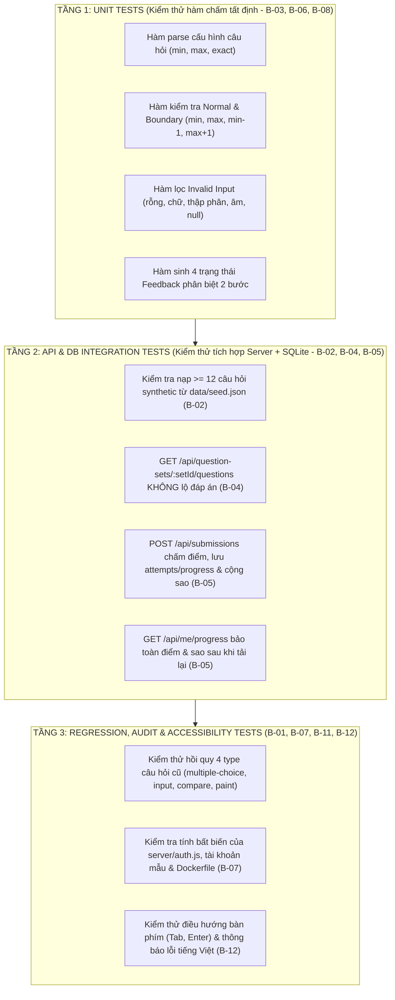

# KẾ HOẠCH KIỂM THỬ HỆ THỐNG (TEST_PLAN.md)
**Dự án:** Vườn Toán Lớp 3 — Dạng bài *"Ước lượng kết quả trước khi tính đúng"* (Track B)

---

## 1. Mục tiêu & Chiến lược Kiểm thử (Test Strategy)

Kế hoạch kiểm thử này được thiết kế nhằm xác minh tính đúng đắn, tính tất định, bảo mật và tính tương thích ngược của tính năng *"Ước lượng kết quả trước khi tính đúng"*, đáp ứng đầy đủ các tiêu chí **B-02, B-03, B-04, B-05, B-06, B-07, B-08, B-09, B-10, B-11, B-12**.

### 1.1. Mô hình phân tầng kiểm thử (3 Tầng)



---

## 2. Môi trường Kiểm thử & Cơ chế Cô lập Dữ liệu (Clean Checkout — B-09, B-10)

### 2.1. Công cụ thực thi
- **Runtime:** Node.js $\ge 18$ (khuyến nghị Node.js `v20 LTS` hoặc `v22 LTS`).
- **Test Runner:** Sử dụng module chuẩn `node:test` và `node:assert/strict` tích hợp sẵn trong Node.js.
- **Lệnh thực thi chuẩn (`B-09`):**
  ```bash
  npm ci
  npm test
  ```

### 2.2. Cơ chế cô lập Cơ sở dữ liệu (Database Isolation)
Để đảm bảo `npm test` chạy an toàn từ một bản clone sạch (clean checkout) mà không cần khởi động server thủ công trước và không làm ghi đè lên file `data/vuon-toan.db` khi phát triển:
1. Trước khi nạp `server/db.js`, trình chạy test gán biến môi trường:
   `process.env.DB_PATH = path.join(os.tmpdir(), 'vuon-toan-test-' + process.pid + '.db')`.
2. Khi `require('../server/db')` được gọi, hệ thống tự động tạo bảng mới và chạy `seedIfEmpty()` + `seedQuestionSets()` để nạp toàn bộ dữ liệu từ `data/seed.json` (bao gồm 12+ câu hỏi `estimate` mới).
3. Sau khi toàn bộ test suite kết thúc (`after()` hook), trình chạy test đóng kết nối SQLite và xóa sạch file DB tạm thời.

---

## 3. Ma trận Kịch bản Kiểm thử Tự động Chi tiết (Automated Test Matrix — B-08)

Giả sử câu hỏi mẫu dùng trong Unit Test có cấu hình chuẩn:
- **Câu hỏi phép nhân (`est-5`):** *"Làm tròn thừa số thứ nhất đến hàng chục để ước lượng rồi tính: $19 \times 6 = ?$"*
- **Tham số tất định:** `min = 110`, `max = 120`, `canonical = 120`, `exact = 114`, `points = 10`.

### 3.1. Nhóm 1 — Kiểm thử Hợp lệ thông thường (`Normal Cases`)

| Mã TC | Mô tả kịch bản | Đầu vào (`givenAnswer`) | Kết quả kỳ vọng (`Expected Output`) |
| :---: | :--- | :--- | :--- |
| **TC-NORM-01** | Nhập đúng số ước lượng chuẩn (`canonical`) và đúng kết quả chính xác (`exact`) | `{ estimate: "120", exact: "114" }` | `estimateOk: true`, `exactOk: true`, `correct: true`, `earnedPoints: 10` |
| **TC-NORM-02** | Nhập số ước lượng nằm giữa khoảng `(min, max)` và đúng `exact` | `{ estimate: "115", exact: "114" }` | `estimateOk: true`, `exactOk: true`, `correct: true`, `earnedPoints: 10` |
| **TC-NORM-03** | Đầu vào có khoảng trắng thừa ở 2 đầu (`" 120 "`, `" 114 "`) | `{ estimate: " 120 ", exact: " 114 " }` | Tự động `.trim()` $\rightarrow$ `estimateOk: true`, `exactOk: true`, `correct: true` |
| **TC-NORM-04** | Đầu vào truyền dưới dạng số nguyên Number thay vì String | `{ estimate: 120, exact: 114 }` | `estimateOk: true`, `exactOk: true`, `correct: true` |
| **TC-NORM-05** | Kiểm tra tính tất định (`B-03`): Gọi hàm chấm 100 lần liên tiếp cùng đầu vào | `{ estimate: "115", exact: "114" }` ($\times 100$ lần) | Cả 100 lần trả về JSON hoàn toàn giống nhau |

---

### 3.2. Nhóm 2 — Kiểm thử Giá trị Biên (`Boundary Cases`)

| Mã TC | Mô tả kịch bản tại biên `[min=110, max=120]` | Đầu vào (`givenAnswer`) | Kết quả kỳ vọng (`Expected Output`) |
| :---: | :--- | :--- | :--- |
| **TC-BND-01** | **Biên dưới hợp lệ (`u === min`):** Ước lượng bằng đúng `110` | `{ estimate: "110", exact: "114" }` | `estimateOk: true`, `exactOk: true`, `correct: true` |
| **TC-BND-02** | **Biên trên hợp lệ (`u === max`):** Ước lượng bằng đúng `120` | `{ estimate: "120", exact: "114" }` | `estimateOk: true`, `exactOk: true`, `correct: true` |
| **TC-BND-03** | **Sát ngoài biên dưới (`u === min - 1`):** Ước lượng bằng `109` | `{ estimate: "109", exact: "114" }` | `estimateOk: false`, `exactOk: true`, `correct: false` |
| **TC-BND-04** | **Sát ngoài biên trên (`u === max + 1`):** Ước lượng bằng `121` | `{ estimate: "121", exact: "114" }` | `estimateOk: false`, `exactOk: true`, `correct: false` |
| **TC-BND-05** | **Biên của kết quả tính đúng (`v === exact - 1`):** Tính đúng lệch 1 đơn vị (`113`) | `{ estimate: "120", exact: "113" }` | `estimateOk: true`, `exactOk: false`, `correct: false` |
| **TC-BND-06** | **Biên của kết quả tính đúng (`v === exact + 1`):** Tính đúng lệch 1 đơn vị (`115`) | `{ estimate: "120", exact: "115" }` | `estimateOk: true`, `exactOk: false`, `correct: false` |
| **TC-BND-07** | **Biên số 0:** Ước lượng bằng `"0"` (với câu có `min > 0`) | `{ estimate: "0", exact: "114" }` | `estimateOk: false`, `exactOk: true`, `correct: false` |

---

### 3.3. Nhóm 3 — Kiểm thử Đầu vào Không hợp lệ (`Invalid Input Cases`)

| Mã TC | Mô tả kịch bản dữ liệu lỗi / dị thường | Đầu vào (`givenAnswer`) | Kết quả kỳ vọng (`Expected Output`) |
| :---: | :--- | :--- | :--- |
| **TC-INV-01** | Bỏ trống cả 2 ô (chuỗi rỗng) | `{ estimate: "", exact: "" }` | Không crash; `estimateOk: false`, `exactOk: false`, `correct: false` |
| **TC-INV-02** | Chỉ nhập khoảng trắng (`"   "`) | `{ estimate: "   ", exact: "114" }` | `estimateOk: false`, `exactOk: true`, `correct: false` |
| **TC-INV-03** | Giá trị câu trả lời là `null` hoặc `undefined` (bỏ qua câu hỏi) | `null` hoặc `undefined` | Không crash; `estimateOk: false`, `exactOk: false`, `correct: false` |
| **TC-INV-04** | Nhập chữ cái tiếng Việt / tiếng Anh | `{ estimate: "một trăm", exact: "abc" }` | `estimateOk: false`, `exactOk: false`, `correct: false` |
| **TC-INV-05** | Nhập số lẫn chữ cái (tránh lỗi `parseInt("115abc") === 115`) | `{ estimate: "115abc", exact: "114" }` | Bị từ chối bởi regex số nguyên: `estimateOk: false`, `correct: false` |
| **TC-INV-06** | Nhập số thập phân (`"115.5"`, `"114.0"`) | `{ estimate: "115.5", exact: "114" }` | Bị từ chối: `estimateOk: false`, `correct: false` |
| **TC-INV-07** | Nhập số âm (`"-115"`) | `{ estimate: "-115", exact: "114" }` | `estimateOk: false`, `exactOk: true`, `correct: false` |
| **TC-INV-08** | Nhập ký tự đặc biệt / biểu thức (`"20*6"`, `"NaN"`, `"Infinity"`) | `{ estimate: "20*6", exact: "Infinity" }` | `estimateOk: false`, `exactOk: false`, `correct: false` |
| **TC-INV-09** | Thiếu 1 trong 2 trường trong object (`{ estimate: "120" }`) | `{ estimate: "120" }` | `estimateOk: true`, `exactOk: false`, `correct: false` |

---

### 3.4. Nhóm 4 — Kiểm thử Ma trận 4 Trạng thái Tính điểm, Phản hồi B-06, Bảo mật B-04 & Lưu trữ B-05

| Mã TC | Yêu cầu | Mô tả kịch bản kiểm thử | Đầu vào (`givenAnswer`) | Kết quả kỳ vọng (`Expected Output`) |
| :---: | :---: | :--- | :--- | :--- |
| **TC-SCORE-01** | **B-03, B-06** | **Trạng thái 1:** Đúng cả hai bước (`estimateOk = true`, `exactOk = true`) | `{ estimate: "120", exact: "114" }` (với câu `19 × 6`) | `estimateOk: true`, `exactOk: true`, `correct: true`, `earnedPoints: 10`, `feedback` chúc mừng trọn vẹn |
| **TC-SCORE-02** | **B-03, B-06** | **Trạng thái 2:** Ước lượng đúng nhưng Tính chính xác sai | `{ estimate: "120", exact: "110" }` | `estimateOk: true`, `exactOk: false`, `correct: false`, **`earnedPoints: 5` (50% điểm)**, `feedback` nhắc tính lại |
| **TC-SCORE-03** | **B-03, B-06** | **Trạng thái 3:** Ước lượng sai nhưng Tính chính xác đúng | `{ estimate: "90", exact: "114" }` | `estimateOk: false`, `exactOk: true`, `correct: false`, **`earnedPoints: 5` (50% điểm)**, `feedback` nhắc làm tròn |
| **TC-SCORE-04** | **B-03, B-06** | **Trạng thái 4:** Sai cả hai bước | `{ estimate: "90", exact: "100" }` | `estimateOk: false`, `exactOk: false`, `correct: false`, **`earnedPoints: 0` (0% điểm)** |
| **TC-SCORE-05** | **ADR-003** | **Tình huống bảo vệ:** Học sinh nhập đúng kết quả chính xác vào ô ước lượng ($u === exact$) | `{ estimate: "114", exact: "114" }` | `estimateOk: true`, `exactOk: true`, `correct: true`, `earnedPoints: 10`, `feedback` có lời khuyên về thói quen làm tròn |
| **TC-SCORE-06** | **B-03, B-05** | Kiểm tra công thức `score_percent` và `correct_count` khi nộp đề thi hỗn hợp | Nộp 2 câu: 1 câu ST-1 (10đ) + 1 câu ST-2 (5đ) / Tổng 20đ | `scorePercent: 75`, `correctCount: 1` (chỉ tính câu đúng cả 2 bước) |
| **TC-SEED-01** | **B-02** | Kiểm tra số lượng câu hỏi `type = 'estimate'` sau khi chạy seed | CSDL SQLite | Có $\ge 12$ câu hỏi trong DB; mọi câu đều có `min <= canonical <= max` và `exact > 0` |
| **TC-SEC-01** | **B-04** | Gọi `GET /api/question-sets/:setId/questions` với bộ đề ước lượng | HTTP GET | HTTP 200; mỗi phần tử có `id, type, prompt, points`, tuyệt đối **không có** `correct_answer`, `correctAnswer`, `min`, `max`, `exact` |
| **TC-SUB-01** | **B-05** | Gửi `POST /api/submissions` với 12 câu trả lời đúng 100% | HTTP POST | HTTP 200; `scorePercent: 100`, `correctCount: 12`, `starsEarned > 0`; bản ghi mới xuất hiện trong bảng `attempts` và `progress.completed === 1` |
| **TC-SUB-02** | **B-05** | Gọi `GET /api/me/progress` và `GET /api/lessons` sau khi nộp bài (mô phỏng F5 Refresh) | HTTP GET | Trả về đúng `bestScore: 100`, `completed: true` và `totalStars` đã cộng, không bị mất trạng thái |
| **TC-SUB-03** | **B-05** | Chống cày sao: Nộp lại cùng bộ đề ước lượng với điểm thấp hơn (`50%`) | HTTP POST | `starsEarned: 0`; `progress.best_score` vẫn giữ nguyên là `100` |
| **TC-REG-01** | **Regression** | Nộp bài bộ đề cũ `phieu-bai-9-10` (gồm `compare`, `input`, `paint`) và `bai-15-kiem-tra` (`multiple-choice`) | HTTP POST | Chấm đúng 100% như trước khi mở rộng hệ thống |
| **TC-AUD-01** | **B-07, B-11** | Kiểm tra tính toàn vẹn của `server/auth.js` và tài khoản mẫu trong DB | File hash / DB | File `server/auth.js` không thay đổi; các tài khoản `hocsinh01`..`99` và `giaovien01` đăng nhập bình thường |

---

## 4. Kịch bản Kiểm thử Giao diện & Khả năng tiếp cận Bàn phím (B-01, B-12)

Bên cạnh bộ kiểm thử tự động chạy bằng `npm test`, nhóm thực hiện danh mục kiểm thử giao diện và bàn phím cho luồng chính:

| Mã KT | Hạng mục kiểm tra | Thao tác thực hiện | Kết quả đạt yêu cầu |
| :---: | :--- | :--- | :--- |
| **UI-01** | Truy cập từ luồng học hiện có (`B-01`) | Đăng nhập `hocsinh01` / `123456` $\rightarrow$ Vào Trang chủ / Mục lục SGK (`muc-luc.html`) hoặc Luyện tập (`exercise.html`) $\rightarrow$ Chọn bài tập Ước lượng | Mở trực tiếp trang làm bài có các câu hỏi ước lượng phép nhân/chia |
| **UI-02** | Điều hướng hoàn toàn bằng bàn phím (`B-12`) | Không dùng chuột: Nhấn `Tab` để vào ô *"Bước 1: Ước lượng"* $\rightarrow$ gõ số $\rightarrow$ nhấn `Tab` sang ô *"Bước 2: Tính đúng"* $\rightarrow$ gõ số $\rightarrow$ nhấn `Enter` để nộp | Có viền sáng (`focus ring`) rõ ràng ở từng ô đang chọn; nộp bài thành công bằng phím `Enter` |
| **UI-03** | Thông báo lỗi dễ hiểu khi nhập sai (`B-12`) | Bỏ trống ô Ước lượng hoặc gõ chữ `"abc"` rồi nhấn `Enter` | Hiển thị thông báo tiếng Việt thân thiện ngay tại câu hỏi, không văng lỗi kỹ thuật thô |
| **UI-04** | Hiển thị phản hồi 2 bước (`B-06`) | Nhập Ước lượng đúng (`120`) nhưng Tính đúng sai (`115`) cho câu `19 × 6` rồi nộp | Giao diện hiển thị rõ: Bước 1 báo Xanh (`Ước lượng hợp lý ✅`), Bước 2 báo Đỏ/Vàng (`Kết quả chính xác chưa đúng ❌`) |

---

## 5. Cấu hình Tích hợp Liên tục (GitHub Actions CI — B-10)

Mọi Pull Request và lượt đẩy code (push) lên repository sẽ được kiểm tra tự động bởi workflow `.github/workflows/ci.yml` với các bước chuẩn:
1. Checkout mã nguồn sạch (`actions/checkout@v4`).
2. Thiết lập môi trường Node.js LTS (`actions/setup-node@v4`, Node `20.x` / `22.x`).
3. Cài đặt phụ thuộc nguyên bản từ lockfile: `npm ci`.
4. Chạy toàn bộ bộ kiểm thử tự động: `npm test`.
5. Chỉ khi 100% test cases trong Mục 3 đạt trạng thái `PASS`, Pull Request mới được đánh dấu xanh (CI Green).
